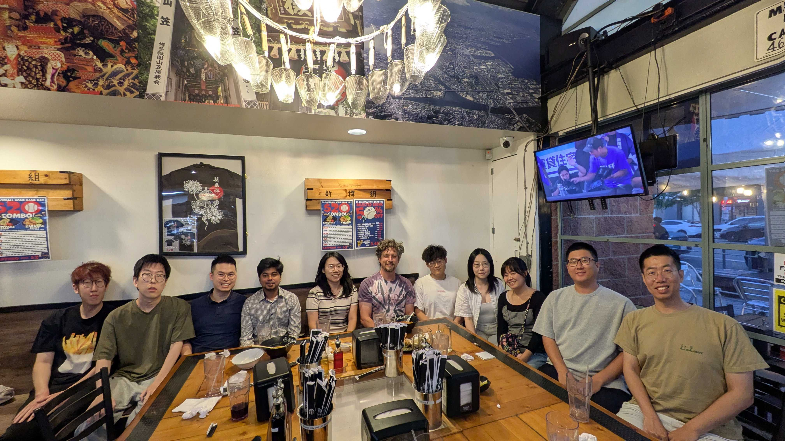
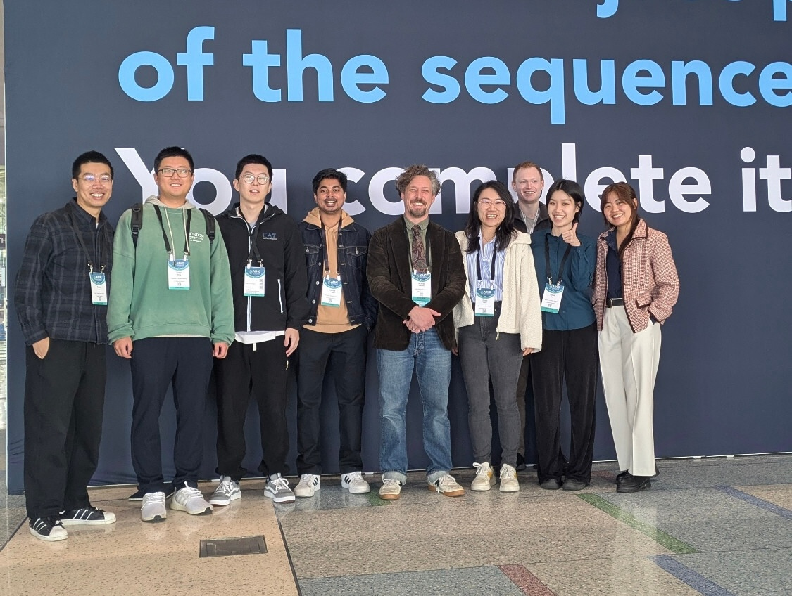

# Join the Lab

We welcome inquiries from prospective trainees with some background in statistics, machine learning, or genetics. A foundation in any one of these areas is enough to get started. We can help you build skills in the others.

If you’d like to join us, tell us what interests you about our [research](research.md) and describe a course or project that helped prepare you. If you’re applying to graduate school, let us know which USC programs you’re considering. If you’re already a USC student, include your program and year. If you’re interested in a postdoc, include your anticipated start date.

For trainee inquiries, collaborations, or questions about our work, email Nick at [nmancuso@usc.edu](mailto:nmancuso@usc.edu).

 
{: .lab-photos }

## Visit the lab

1450 Biggy Street 
Norris Research Tower, Room G517G 
Los Angeles, CA 90033

<iframe class="lab-map" title="Map showing Norris Research Tower at 1450 Biggy Street in Los Angeles" src="https://maps.google.com/maps?q=1450+Biggy+Street,+Los+Angeles,+CA+90033&amp;z=14&amp;output=embed" loading="lazy" referrerpolicy="no-referrer-when-downgrade"></iframe>
